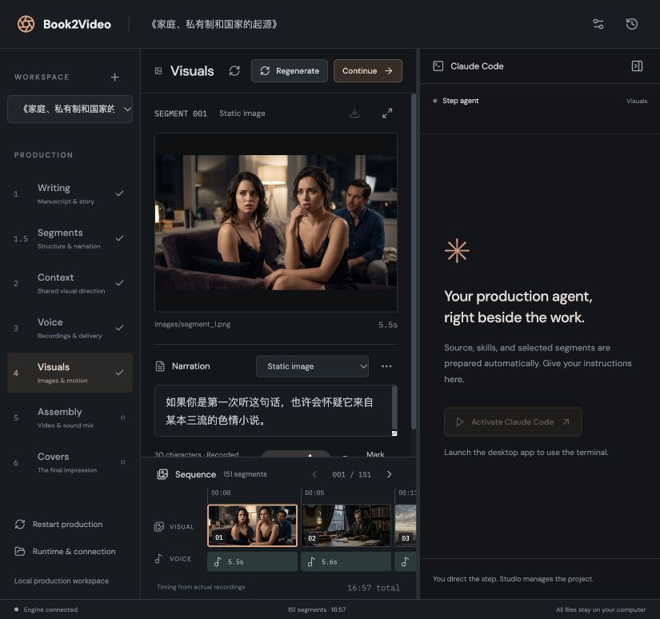

# Book2Video Studio

**English** · [简体中文](#简体中文)

A standalone desktop app (Tauri 2) that turns books and manuscripts into narrated videos. Write the script with Claude Code, edit it segment by segment, generate voice and visuals (AI images or HTML / Three.js motion graphics), assemble landscape and 3:4 videos, and make covers.



## Features

- **Six steps:** Writing → Segments → Voice → Visuals → Assembly → Covers.
- **Writing:** work with Claude Code in a built-in terminal, from a source document or just a topic. Titles, cover copy and opening quotes each have several editable candidates.
- **Segments:** edit each narration directly in the list. Every segment has an **Image / Motion** switch: *Image* is generated by an image API in Visuals, *Motion* is built by Claude Code with HTML / Three.js.
- **Visuals:** a shared "visual direction" keeps every image and clip consistent; batch-generate or fill missing images; render saved motion compositions.
- **Assembly and covers:** landscape and 3:4 videos with subtitles, music and an optional opening quote; several cover candidates.
- **Editable skills and templates:** writing skills, image/motion styles and all prompt templates can be edited, imported and restored from history.
- **Safe editing:** every save and regeneration keeps a revision; outputs are marked for rebuilding instead of being silently replaced.
- **Private by design:** API keys live in macOS Keychain / Windows Credential Manager and never reach the interface or project files.
- **Bilingual interface:** English and 简体中文 (Settings → Language).

## Standalone by design

The packaged app needs nothing installed on the computer. It ships:

- the production engine (code, prompts, skills, background music, default settings);
- Python 3.13 with the engine's packages, and the Claude Code CLI bundled by `claude-agent-sdk`;
- Node.js 22, the pinned browser automation libraries and Chrome Headless Shell;
- static FFmpeg and FFprobe.

**System check** (bottom of the sidebar) lists every bundled component. You only need your own API keys, in **Settings → API keys**, grouped by what they do:

- **Language models** (DeepSeek, Kimi, MiMo, OpenRouter, SiliconFlow, Volcengine): writing, agent segmentation, visual direction and the Claude Code motion agent (only when a segment uses motion). Each step uses the provider chosen in its settings. Static images need no language model.
- **Image generation** (Volcengine Seedream, Google): segment images, the opening background and covers. Google ADC uses your Google Cloud login instead of a key; **Check connection** in Settings → API keys confirms the login, project and models, and shows when it last passed.
- **Voice** (ByteDance TTS): narration. The default voice works out of the box; enter your own **Voice ID** in Settings (a cloned voice `S_…` works too, and the matching TTS resource is chosen automatically). **Opening masthead** in Settings sets the channel name shown on the opening; it is empty by default.

The tab lists exactly which keys the open project needs for the whole production and which are missing. A reminder in the header shows how many are missing, and a step whose key is not saved opens the API keys tab instead of starting.

### Claude Code: API key or subscription

Writing, Visuals (motion segments), Assembly in Claude Code editing mode, and Covers in HTML / Three.js mode work with Claude Code in a terminal on the right. Edit every agent's instructions in **Settings → Skills & templates**, under the numbered Writing, Visual, Assembly or Cover templates. This includes Studio session guidance, motion-reference/style guidance and the Assembly editing contract. Saved edits apply to new and revised sessions. The existing segmentation template remains in Step 2. **Settings → API keys → Claude Code** chooses how it runs:

- **Built-in Claude Code · API key** (default): the copy bundled with Studio, connected to the language-model provider chosen for Writing and Motion.
- **Your Claude Code · subscription:** the Claude Code installed on this computer, signed in with your Claude account, so your Claude plan covers those sessions and they need no key. Studio finds it (even when opened from the Finder), shows its version and sign-in, and starts it without any provider settings. Agent segmentation and the other background steps still use API keys.

## Where your files live

| What | Where |
|---|---|
| Projects | `~/Movies/Book2Video Studio` by default, or any folder you choose. **Open project folder** adds an existing production. |
| Skills and templates | An editable copy in the app data folder (`~/Library/Application Support/com.book2video.studio/library`). App updates add new bundled files and refresh files you never changed; your edits and deletions are kept. |
| Logs | `logs/service.log` in the app data folder. |

Removing a project (trash icon beside **Projects**) only takes it off the list unless you tick *Also permanently delete the project files*. macOS asks once before the app reads projects in Desktop, Documents or Downloads.

More detail on every screen and rule: [docs/DETAILS.md](docs/DETAILS.md).

## Build from source

> **The build needs the production engine.** `npm run stage` copies the engine (`core`, `prompts`, `skills`, `music`, `config.example.yaml`) from the **AIGC_Video_CLI** project. Put it beside this folder (`../AIGC_Video_CLI`) or set `STUDIO_ENGINE_ROOT`. The engine is not part of this repository.

Requirements: macOS on Apple silicon, Node.js 22+, Rust (stable), and an internet connection for the first build.

```sh
npm install
npm run stage           # assemble build/runtime, build/engine and build/backend
npm run desktop         # run the app in development
npm run desktop:build   # make the .app and .dmg (about 2 GB: it carries every runtime)
```

`npm run stage` downloads pinned, checksum-verified copies of Python, Node.js, FFmpeg/FFprobe and Chrome into `build/downloads`, installs `runtime/requirements.lock` and `runtime/motion/package-lock.json`, copies the engine and smoke-tests every component. It is rebuilt only when a pin or lock file changes. The engine's `.env`, `config.yaml`, `input/` and `output/` are never copied.

Checks:

```sh
npm test                                        # language tests + backend tests on the staged Python
npm run build
cargo test --manifest-path src-tauri/Cargo.toml
```

## Architecture

- `src/` — React/TypeScript workspace; xterm.js terminal.
- `src-tauri/` — Rust host: credential storage, PTY terminal, the bundled runtime's environment, service lifetime. Every child process gets the bundled programs first on `PATH`; the user's Python settings are cleared.
- `backend/server.py` — authenticated loopback project service: revisions, invalidation, job supervision, media streaming.
- `backend/runner.py` — isolated process that runs the engine's real stage functions.
- `backend/library.py` — editable skills and templates, seeded from the bundled engine.
- `backend/context.py`, `backend/agent_env.py` — agent prompts; provider credentials are passed straight to the native child process.
- `scripts/stage.mjs`, `runtime/` — assembles the bundled runtime from pinned versions and lock files.

See [GUI_DESIGN_REVIEW.md](GUI_DESIGN_REVIEW.md) and [IMPLEMENTATION_REVIEW.md](IMPLEMENTATION_REVIEW.md) for design decisions and validation notes.

## Before public distribution

- **Platforms:** only macOS on Apple silicon is packaged. Intel Macs and Windows need their entries in `PLATFORMS` in `scripts/stage.mjs`; the host code is platform-neutral but untested there.
- **Signing:** sign every bundled executable (Python extensions, Node.js, Chrome, FFmpeg, Claude Code) with a Developer ID and hardened runtime, then notarize. Unsigned builds are a new app to macOS after every rebuild, so the folder-access question returns.
- **Licenses:** [runtime/THIRD_PARTY_NOTICES.md](runtime/THIRD_PARTY_NOTICES.md) lists the bundled components. FFmpeg (GPL-3.0) and PyMuPDF (AGPL-3.0) require offering their source; Puppeteer is Apache-2.0 and Three.js is MIT. This repository does not yet contain a license for its own code.

---

<a id="简体中文"></a>

# Book2Video Studio（简体中文）

[English](#book2video-studio) · **简体中文**

一款独立运行的桌面应用（Tauri 2），把书籍和文稿做成有旁白的视频。用 Claude Code 写稿，逐段编辑，生成配音和画面（AI 图片或 HTML / Three.js 动画），合成横屏和 3:4 视频，并制作封面。


## 功能

- **六个步骤：** 写作 → 分段 → 配音 → 画面 → 合成 → 封面。
- **写作：** 在内置终端中与 Claude Code 协作，可基于资料写作，也可只给主题。视频标题、封面文案和开场金句都有多个可编辑的候选。
- **分段：** 直接在列表里编辑每段旁白。每段都有 **图像 / 动画** 开关：*图像* 在“画面”步骤由图像 API 生成，*动画* 由 Claude Code 用 HTML / Three.js 制作。
- **画面：** 统一的“画面基调”让所有图片和片段风格一致；可批量生成或补全缺失图片；渲染已保存的动画作品。
- **合成与封面：** 带字幕、音乐和可选开场金句的横屏与 3:4 视频；多个封面候选。
- **可编辑的 Skills 与模板：** 写作 Skills、图片/动画风格和所有提示词模板都可编辑、导入，并可从历史中恢复。
- **安全编辑：** 每次保存和重新生成都会保留修订版本；受影响的产物会被标记为“需要重做”，不会被悄悄覆盖。
- **隐私优先：** API 密钥保存在 macOS 钥匙串 / Windows 凭据管理器中，不会进入界面或项目文件。
- **双语界面：** English 与 简体中文（设置 → 语言）。

## 开箱即用

打包后的应用无需在电脑上安装任何东西，已内置：

- 制作引擎（代码、提示词、Skills、背景音乐、默认设置）；
- Python 3.13 及引擎所需的软件包，以及 `claude-agent-sdk` 自带的 Claude Code CLI；
- Node.js 22、固定版本的浏览器自动化库，以及 Chrome Headless Shell；
- 静态编译的 FFmpeg 和 FFprobe。

侧边栏底部的 **系统检查** 会列出所有内置组件。你只需要在 **设置 → API 密钥** 中准备自己的密钥，它们按用途分组：

- **语言模型**（DeepSeek、Kimi、MiMo、OpenRouter、SiliconFlow、火山引擎）：写作、智能体分段、画面基调，以及 Claude Code 动画智能体（仅当有段落使用动画时）。每个步骤使用其设置中选择的服务商。静态图片无需语言模型。
- **图像生成**（火山引擎 Seedream、Google）：分段图片、开场背景和封面。Google ADC 使用你的 Google Cloud 登录，无需密钥；在 设置 → API 密钥 中点击 **检查连接** 可确认登录、项目和模型，并显示上次检查时间。
- **配音**（字节跳动 TTS）：旁白配音。默认音色可直接使用；也可在设置中填写自己的 **音色 ID**（支持 `S_…` 复刻音色，会自动匹配对应的 TTS 资源）。设置中的 **开场刊头** 用于开场显示的频道名，默认留空。

该页面会列出当前项目完成整个制作所需的全部密钥，以及缺少哪些。缺少密钥时，顶部会显示提醒；某个步骤缺少密钥时，会打开 API 密钥页面而不是直接开始。

### Claude Code：API 密钥或订阅

写作、画面（动画段落）、Claude Code 剪辑模式下的合成，以及 HTML / Three.js 模式下的封面，在右侧终端中与 Claude Code 协作。在 **设置 → API 密钥 → Claude Code** 中选择运行方式：

- **内置 Claude Code · API 密钥**（默认）：使用 Studio 自带的 Claude Code，连接写作和动画所选的语言模型服务商。
- **你的 Claude Code · 订阅：** 使用本机安装的 Claude Code，并以你的 Claude 账号登录，这些会话由你的 Claude 订阅承担，无需密钥。Studio 会自动找到它（即使从访达打开），显示版本和登录状态，并在不带任何服务商设置的情况下启动它。智能体分段和其他后台步骤仍使用 API 密钥。

## 文件保存在哪里

| 内容 | 位置 |
|---|---|
| 项目 | 默认为 `~/Movies/Book2Video Studio`，也可选择任意文件夹。**打开项目文件夹** 可添加已有的制作项目。 |
| Skills 与模板 | 应用数据文件夹中的可编辑副本（`~/Library/Application Support/com.book2video.studio/library`）。应用更新会添加新的内置文件，并刷新你从未改动的文件；你的修改和删除会被保留。 |
| 日志 | 应用数据文件夹中的 `logs/service.log`。 |

移除项目（“项目”旁的垃圾桶图标）默认只把项目从列表中移除；勾选“同时永久删除项目文件”才会删除文件夹。macOS 会在应用首次读取“桌面 / 文稿 / 下载”中的项目前询问一次权限。

各界面与规则的更多细节（英文）：[docs/DETAILS.md](docs/DETAILS.md)。

## 从源码构建

> **构建需要制作引擎。** `npm run stage` 会从 **AIGC_Video_CLI** 项目复制引擎（`core`、`prompts`、`skills`、`music`、`config.example.yaml`）。请把它放在本文件夹旁边（`../AIGC_Video_CLI`），或设置环境变量 `STUDIO_ENGINE_ROOT`。引擎不属于本仓库。

环境要求：Apple 芯片的 macOS、Node.js 22+、Rust（stable），首次构建需要联网。

```sh
npm install
npm run stage           # 组装 build/runtime、build/engine 和 build/backend
npm run desktop         # 开发模式运行
npm run desktop:build   # 生成 .app 和 .dmg（约 2 GB，因为内置了全部运行环境）
```

`npm run stage` 会下载固定版本并校验过校验和的 Python、Node.js、FFmpeg/FFprobe 和 Chrome 到 `build/downloads`，安装 `runtime/requirements.lock` 与 `runtime/motion/package-lock.json`，复制引擎并对每个组件做冒烟测试。只有版本或锁定文件变化时才会重新构建。引擎的 `.env`、`config.yaml`、`input/` 和 `output/` 绝不会被复制。

检查：

```sh
npm test                                        # 语言测试 + 基于内置 Python 的后端测试
npm run build
cargo test --manifest-path src-tauri/Cargo.toml
```

## 架构

- `src/` — React/TypeScript 工作区；xterm.js 终端。
- `src-tauri/` — Rust 宿主：凭据存储、PTY 终端、内置运行环境的环境变量、服务生命周期。所有子进程都优先使用内置程序，并清除用户的 Python 设置。
- `backend/server.py` — 带认证的本地回环项目服务：修订版本、失效标记、任务监管、媒体流。
- `backend/runner.py` — 隔离进程，运行引擎真正的各步骤函数。
- `backend/library.py` — 可编辑的 Skills 与模板，从内置引擎初始化。
- `backend/context.py`、`backend/agent_env.py` — 智能体提示词；服务商凭据直接传给原生子进程。
- `scripts/stage.mjs`、`runtime/` — 按固定版本和锁定文件组装内置运行环境。

设计决策与验证记录见 [GUI_DESIGN_REVIEW.md](GUI_DESIGN_REVIEW.md) 和 [IMPLEMENTATION_REVIEW.md](IMPLEMENTATION_REVIEW.md)。

## 公开分发前须知

- **平台：** 目前只打包 Apple 芯片的 macOS。Intel Mac 和 Windows 需要在 `scripts/stage.mjs` 的 `PLATFORMS` 中添加对应条目；宿主代码与平台无关，但尚未在这些平台上测试。
- **签名：** 需要用 Developer ID 和 Hardened Runtime 对所有内置可执行文件（Python 扩展、Node.js、Chrome、FFmpeg、Claude Code）签名并公证。未签名的构建每次重新编译后在 macOS 眼中都是新应用，文件夹访问权限的询问会再次出现。
- **许可证：** [runtime/THIRD_PARTY_NOTICES.md](runtime/THIRD_PARTY_NOTICES.md) 列出了内置组件。FFmpeg（GPL-3.0）和 PyMuPDF（AGPL-3.0）要求提供其源代码；Puppeteer 采用 Apache-2.0 许可证，Three.js 采用 MIT 许可证。本仓库目前还没有为自身代码添加许可证。

### Covers: Image API or Claude Code + HTML / Three.js

Step 6 starts with a method selector, selected cover copy, shared size/candidate controls, and cover styles. Existing projects default to Image API. In Claude Code mode, **New cover design** opens the same agent runtime and login used by Writing (including Writing’s provider/model in API-key mode). The agent composes separate HTML files for each size and candidate using local Three.js 0.160.0, then checks PNG snapshots with bundled Chrome. **Finish & render covers** publishes new PNG candidates to the existing gallery. **Revise HTML design** copies the previous design into a new session; **Render saved HTML** retries rendering without another agent call. Existing candidates and the selected cover are retained.

HTML cover designs live in `.studio/cover-designs/<session>/`, with `studio-payload.json`, source HTML, local assets and `previews/`. Each HTML signals `window.__ready = true` only after its static scene, fonts and assets are ready. Studio screenshots exact requested pixel dimensions with device scale 1; missing assets or script errors fail the render before any final candidates are published. Changes to cover copy, sizes, candidate count or style require revising the design before rendering. Agent sessions run exclusively; API cover jobs can still run beside recordings, visuals or assembly.

### 封面：图像 API 或 Claude Code + HTML / Three.js

步骤 6 顶部可选择生成方式，并查看已选封面文案、尺寸、候选数量和风格。已有项目默认使用图像 API。Claude Code 模式沿用“写作”的智能体运行方式和登录；API 密钥模式也沿用写作的服务商及模型。新建设计后，智能体为各尺寸分别编写 HTML，使用本地 Three.js 和内置 Chrome 检查快照。点击“结束并渲染封面”后，PNG 候选进入原有画廊。“修改 HTML 设计”会复制上次的源码供修改；“渲染已保存的 HTML”可直接重试渲染。已有候选和已选封面都会保留。

### Step 5: Claude Code editing

Choose **Standard assembly** or **Claude Code editing** on the Assembly page. The existing assembler remains the default. The editing agent uses the same Claude Code login, provider and model as Writing. Choose one of three editable skills: **Editorial explainer**, **Cinematic essay**, or **Kinetic social**. **Edit editing skills** opens the shared library; custom skills can be imported there.

**New video edit** prepares the current selected visuals, recordings, narration, export settings and music catalog in `.studio/edits/<session>/`. Claude Code edits `plan.json` with keyword/quote/comparison/chart emphasis, chapter cards, pacing, captions, music and sound cues. Custom scene HTML permits richer motion. **Revise saved edit** copies a prior design, including invalid plans that need repair, while retaining its original files. The plan keeps every narration segment in order. The common compiler and renderer are shared by all three skills.

The agent runs capabilities → check → preview → render → publish, reviewing contact sheets and revising when needed. **Finish session** only closes the editing conversation. Ending an unchanged session preserves the current video without starting a full render. **Render saved edit** renders without another agent call. Source media and canonical manuscripts are never rewritten by the renderer. Long videos render in bounded two-minute HTML chunks, followed by one audio mix and frame-exact assembly. Music volume, normalization and ducking, narration speed, transitions, subtitles, zoom, export size and codec remain available. The final master is `final_video.mp4`, with `final_video.srt` and `final_video.qa.json`; the optional 3:4 copy uses the existing panel settings. A failed/cancelled job keeps the previous exports. Publication has rollback and a recovery journal for forced shutdowns.

Caption timings begin as **estimated**. The agent can run `python studio_edit.py align` using a local `whisper-cli` and Whisper small model (default `~/.cache/book2video/whisper/models/ggml-small.bin`, or `STUDIO_WHISPER_MODEL`). It aligns canonical words to ASR timestamps and records transcript similarity; poor matches require review. Without local Whisper, the agent can review cue times manually. Estimated captions are labelled and reported rather than presented as speech-aligned.

### 步骤 5：Claude Code 剪辑

“合成”页面可选择标准合成或 Claude Code 剪辑。剪辑沿用写作的 Claude Code 登录、服务商和模型，并提供编辑式讲解、电影感随笔、活力社交视频三种可编辑技能。智能体基于当前录音和已选画面编辑 `plan.json`，添加章节、重点动效、比较和图表、字幕、音乐及音效；也可制作自定义场景 HTML。先检查短预览和帧合集，再点击“结束并渲染视频”。修改已有剪辑会复制原设计；结束未改动的会话不会自动开始完整渲染。渲染失败或取消会保留先前的导出，强制退出后的发布恢复也有日志保护。

字幕时间初始为估算，界面与 QA 报告会明确标记。可使用本地 Whisper 对齐，也可由智能体对照录音人工检查；所有字幕保持原文内容。

### 中文制作指令与硬件加速

桌面版的写作、画面、精剪和封面会话模板使用简体中文。写作技能沿用引擎中的中文稿件；HTML 动画与三种精剪技能使用桌面版中文入口。`scripts/stage.mjs` 先复制引擎，再覆盖桌面版的 `prompts/` 与 `skills/`，因此打包和开发环境使用同一套说明。命令、JSON 字段、占位变量和风格标识保留原名，保证模板仍可执行。两个阶段共用浏览器渲染契约和本机能力报告，Agent 负责渲染、检查和修复循环。

所有 Apple Silicon M 系列 Mac（各代基础款、Pro、Max、Ultra 及后续型号）均优先使用原生 Metal GPU 绘制和 VideoToolbox 视频编码。保存的动态片段和精剪 HTML 渲染显式请求 `--browser-gpu --gpu`；精剪素材适配、分块和最终编码会先按实际输出尺寸测试硬件编码器，只有不可用或实际失败时才记录原因并回退 CPU。浏览器 GPU 绘制与媒体引擎编码分别核实，不能只凭 GPU 占用率判断。

Windows 指南包含 NVIDIA NVENC、Intel QSV、AMD AMF 的驱动检查和短片测试，集成显卡同样应检查。完整说明在精剪渲染契约和共享 HTML 动画技能中；Windows 后端选择以模拟测试验证，当前打包脚本仍仅支持 macOS arm64。

应用更新会刷新未修改过的内置库文件；用户自行编辑或删除的模板与技能保留原状。既有会话保留启动时的指令快照，新说明用于新建或修订会话。

### 音色库与模型选择

“设置 → 制作设置”中，语音合成模型可选择 `seed-tts-2.0-standard`（标准版）或 `seed-tts-2.0-expressive`（表现力增强版）。默认音色为 `S_MKj17k802`。填写音色 ID 和便于辨认的名称，点击“保存音色”，即可在本机所有项目中复用；再次保存相同 ID 会更新名称。音色库保存在应用资料目录的 `voices.json`，应用重启后仍可使用。选择音色后，点击“保存设置”才应用到当前项目。

火山引擎生图预设为 `doubao-seedream-5-0-pro-260628`、`doubao-seedream-5-0-260128`、`doubao-seedream-5-0-flash-260915`；Google API 与 ADC 均提供 `gemini-nano-banana-2.1` 和 `gemini-3.1-flash-image`。分段配图和 API 封面共用这些选项，均可选“自定义”输入其他模型 ID，已有自定义配置不会被列表覆盖。

### Step 4 browser motion clips

Visuals uses local HTML/SVG/GSAP/Three.js, Chrome frame capture and FFmpeg encoding. It does not invoke HyperFrames. Each clip exposes `window.clip` with dimensions, duration, a readiness Promise and `renderAt(seconds)`. Agents run `python render.py check --snapshots`; Studio verifies silent MP4 dimensions, frame count and duration before replacing a take. DOM caption-zone checks and sampled backward seeks are automatic; Canvas content and visual quality still require screenshot review. Step 5 uses the same browser renderer, including awaited video seeking. HyperFrames is no longer bundled.

### Agent-controlled rendering

Motion agents run `python render.py capabilities`, `check --snapshots`, `preview` and `render`. Editing agents run `python studio_edit.py capabilities`, `check`, `preview`, `render` and `publish`. Renderer scripts control Chrome/FFmpeg and return measured capabilities, progress, screenshots and source-bound verification reports. Agents review real frames and fix problems before publishing; an ended session never launches another export. Verified unchanged previews/candidates are reusable. The app discovers the files and displays progress/results.

Use `--browser-mode auto|hardware|software` and `--encoder auto|software`; hardware is tried first and software fallback reasons are recorded. Packaged dependencies use `AIGC_MOTION_MODULES`, `AIGC_BROWSER_PATH`, `AIGC_FFMPEG_PATH` and `AIGC_FFPROBE_PATH`. Earlier custom framework references and incompatible prompts are archived outside the active library. Current packaging supports macOS arm64; Windows encoder selection has mocked tests, and native Windows/Linux exports need platform testing.

### Segmentation and voice controls

Step 2 contains **Split method** and, in **Agent (split by meaning)** mode, **Target segments**. **Split by punctuation** splits at English/Chinese periods, question marks, exclamation marks and semicolons, retaining punctuation and closing quotes. It keeps decimal numbers together and does not group sentences to meet a target count. **One segment per line** remains available. Existing `auto` settings now use punctuation mode; existing segments remain until regenerated.

Step 3 contains **TTS model**, **Speaking rate** (−50 to 100, 0 is normal) and **Emotion**. These controls save automatically and apply to new recordings. Agent provider/model and voice selection remain in Settings.

Writing setup offers **No skill**. This applies to direct writing and writing from a document: Claude Code follows the user’s instructions without loading a writing skill, while retaining Studio’s raw JSON output contract. Save the setup or activate Claude Code to apply it to the next session.

### Agent task context

Every Claude Code session receives a task brief and a source snapshot in `task.json` (interactive sessions) or a `*.task.json` sidecar beside its SDK session log. These identify the current step, authoritative inputs and revisions, permitted outputs, protected files, selected objects and completion checks. The scope is a prompt contract, not an operating-system sandbox. Existing renderer/source validation remains responsible for rejecting stale media.

Writing, agent segmentation, motion, assembly and cover design have separate boundaries. Deterministic segmentation, TTS and image API jobs retain their existing workflows. Direct writing waits for a topic; **No skill** remains supported. Segmentation cannot rewrite its source. Motion changes only the selected take folders; assembly publishes through its provided tool; cover agents preview HTML and let Studio publish final PNGs when the session ends.

Only the relevant skill folders are supplied to interactive sessions. Motion batches share technical/style instructions once and keep separate per-segment payloads. Cover context points to the manuscript instead of duplicating it. Reference reads, review agents and rerenders are driven by a specific need; finished artifacts and large logs are kept in files. `context_chars` records actual prompt length in interactive launch metadata. These changes apply to new sessions; restart development's Python service after backend edits.
