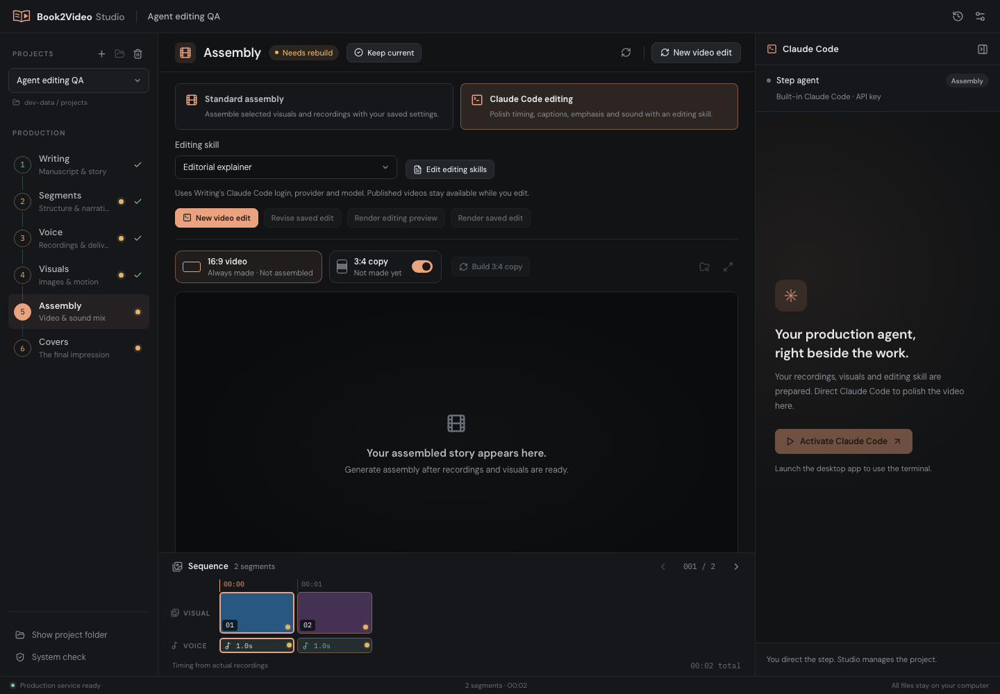
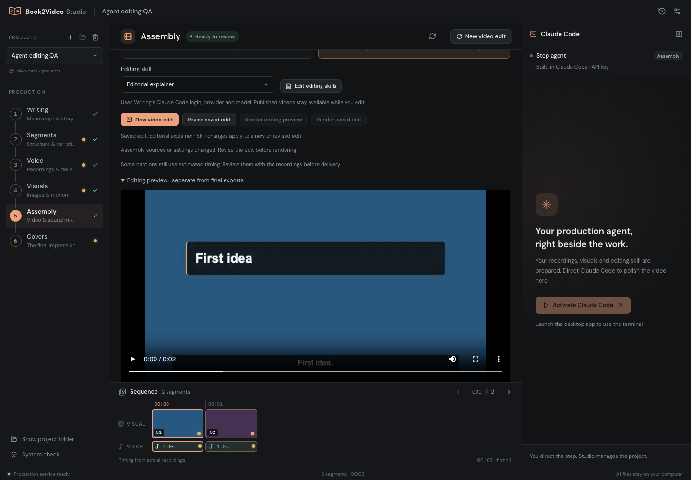
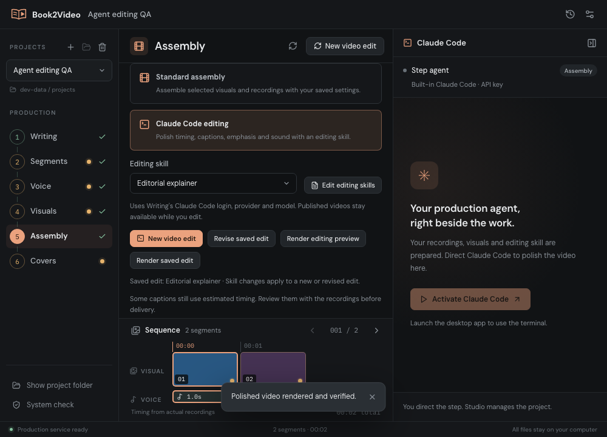

# Step 5: Claude Code editing

Verified on 2026-10-13. Assembly keeps the existing standard mode and adds Claude Code editing with three editable skills, isolated saved plans, preview video/contact sheets and verified final exports. The editing agent uses Writing's Claude Code login, provider and model.

## Environment

- macOS arm64; staged Python, Node 22.23.3, Chrome Headless Shell 152, HyperFrames 0.8.150, FFmpeg 9.0.2 and GSAP 3.14.2.
- UI: http://127.0.0.1:1420/, 1440 × 1000 and 1000 × 720 windows.
- Playwright from the existing workspace dependencies; a browser plugin/skill was unavailable in this session.
- Isolated development project: `Step 5 Agent Editing QA_6`. Rendering tests use temporary projects, including paths with spaces and Chinese characters.

## Checks

| Check | Result |
|---|---|
| Standard assembly remains the default | Pass |
| Agent mode and three skill selections persist | Pass |
| Skill library opens and exposes all three packages | Pass |
| Assembly and Writing resolve the same agent provider environment | Pass |
| Saved plans refresh the UI; revisions retain original files | Pass |
| Invalid plans can be reopened for repair | Pass |
| Unchanged sessions preserve review and do not trigger rendering | Pass |
| Preview video loads and seeks in the browser | Pass: 640 × 360, 2 seconds |
| Real render job publishes landscape, 3:4, SRT and QA report | Pass |
| Canonical caption text and narration order are preserved | Pass |
| Speed, pauses, captions and overlays share one clock | Pass |
| Recording tails are padded to frames rather than truncated | Pass |
| Chunk boundaries preserve video, zoom, overlays and captions | Pass |
| Opening quote, custom HTML and motion clips render | Pass |
| Transition families preserve duration and avoid unintended black frames | Pass |
| Music ducking reduces music relative to narration | Pass |
| Changed sources/settings are rejected before publication | Pass |
| Failure/cancellation keeps prior exports | Pass |
| Partial publication rollback and forced-shutdown recovery | Pass |
| Corrupt recovery journals retain backups and allow service startup | Pass |
| Existing standard assembly, cover, voice, project and library regressions | Pass |
| Compact layout, meaningful page, no Vite overlay or browser errors | Pass |

`npm test` passed **180 Python tests and 16 JavaScript checks**, including 25 editing tests. `npm run stage`, `npm run tauri -- build --bundles app` and `git diff --check` passed. The macOS bundle includes the editing backend, all three skills and local GSAP. The build retains the existing Vite large-chunk advisory.

## Interaction loop

Open Assembly → verify standard default → choose Claude Code editing → select each skill and check persistence → open the skill library → prepare an isolated session through the service → save a deterministic editing plan → finish → render and inspect the preview → render the saved edit → verify landscape/3:4 exports → switch back to standard and confirm retained exports → check compact layout.

Browser playback was separately checked after metadata loaded: ready state 4, 640 × 360, 2-second duration and a successful seek to 0.5 seconds.

Copied Michael Woodford recordings and visuals also exercised local Whisper alignment and all three render themes. Transcript similarity was 0.889 and 0.923; each theme produced a 1280 × 720, 180-frame preview with no timing warnings. The original production was not modified.

## Limits

Deterministic plans and HTML fixtures validate the real rendering pipeline. No paid model-generation request was made, and a new interactive native Claude Code generation session was not exercised. Local Whisper requires `whisper-cli` and a configured model; manual caption review remains available. Windows, Intel Macs and a complete long production export were not tested. Chunk seams were exercised with small boundaries to test the same bounded-render path.

## Screenshots

