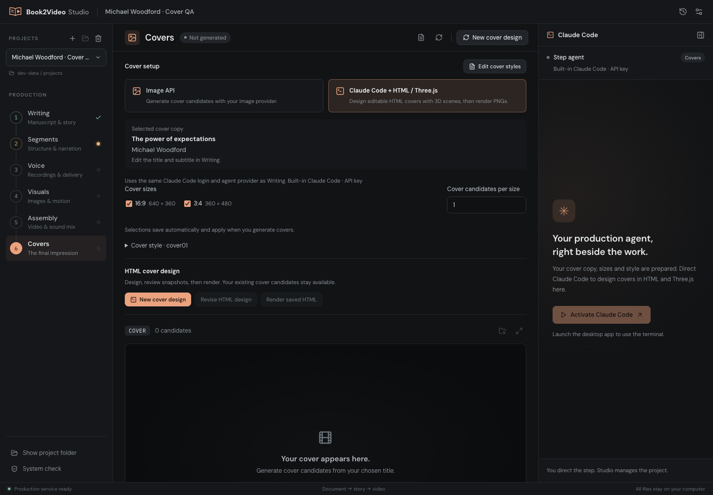
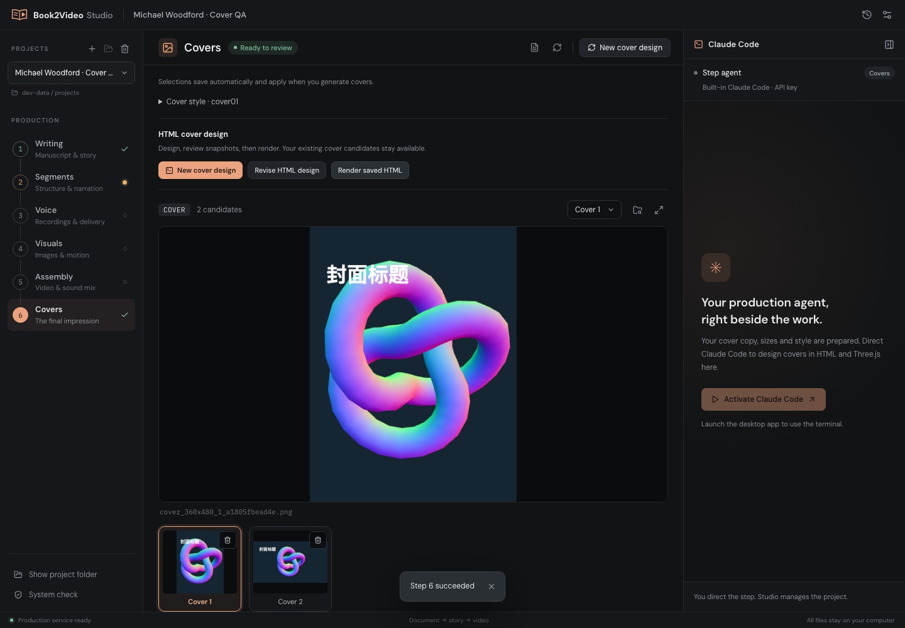
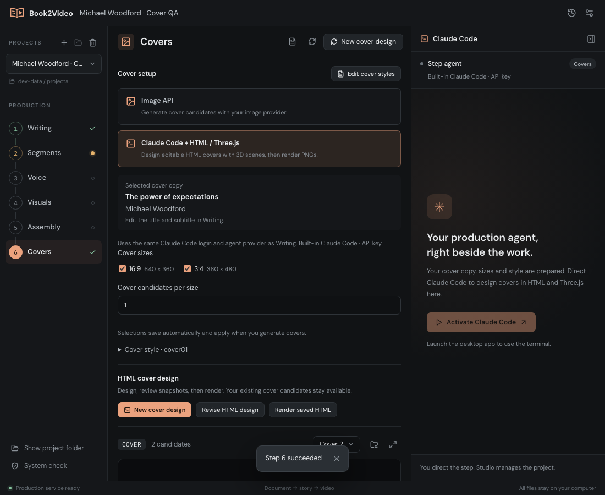

# Step 6: Image API and Claude Code HTML covers

Verified on 2026-10-13. Step 6 now offers Image API (the existing default) and Claude Code + HTML / Three.js. Shared copy, sizes, candidate count and styles sit above the preview; HTML mode adds the agent pane, design/revision controls and snapshot review. Both methods keep candidates in the existing gallery.

## Environment

- macOS arm64, staged Node 22.23.3, Chrome Headless Shell 152, Three.js 0.160.0.
- UI: http://127.0.0.1:1420/, 1440 × 1000 and 1100 × 900 windows.
- Playwright from the existing bundled workspace dependencies. Browser plugin/skill not available in this session.
- Isolated development project: `Step 6 HTML QA`; the Michael Woodford production was read as a reference and was not modified.

## Checks

| Check | Result |
|---|---|
| Correct title and URL, meaningful rendered page | Pass |
| No Vite overlay, no JavaScript/console errors | Pass |
| API is the default for existing settings | Pass |
| Method selection saves and reveals/hides the terminal | Pass |
| Selected cover copy and independent size selections | Pass |
| Real HTML render job produces landscape and portrait candidates | Pass |
| Selecting a candidate persists; switching methods keeps candidates | Pass |
| Compact window: controls wrap without overlap | Pass |
| HTML revisions copy sources and preserve original designs | Pass |
| Snapshot saves change project revision and refresh preview URLs | Pass |
| Copy/setup changes require design revision before rendering | Pass |
| Broken assets fail before final PNGs are published | Pass |
| Cover agent provider environment equals Writing's environment | Pass |
| Existing API, project, library, voice and motion regressions | Pass |

15 JavaScript checks and 155 Python tests passed (`npm test`). `npm run build`, runtime staging, `npm run tauri -- build --bundles app`, and `git diff --check` passed. The macOS application bundle includes the HTML cover renderer and local Three.js. The build retains the existing Vite large-chunk advisory.

## Interaction loop

Open Covers → verify API default → choose Claude Code + HTML / Three.js → verify saved setting and terminal → switch back to API and again to agent → prepare a cover session through the service → save deterministic Three.js fixture HTML → finish the session → click Render saved HTML → review two PNG candidates → select the second → switch methods and confirm retained candidates → check compact window.

The real renderer also produced exact-size 640 × 360 and 360 × 480 PNGs, with nonblank WebGL scenes, and retained earlier candidates across repeated renders. Fixtures were used to validate rendering; no model generation request was sent. The interactive native Claude Code generation session itself and Windows rendering remain untested in this change.

## Screenshots

